# Project III: Diagnosing PINN Failure in Sparse-Data Field Reconstruction

## Sparse-Data Reconstruction of a Transient Heat Field Using a Physics-Informed Neural Network

---

## 1. Researcher Outreach and Interview

### 1.1 Outreach Log

| Item | Information |
|---|---|
| Researcher | **[ADD RESEARCHER NAME]** |
| Affiliation / Position | **[ADD TITLE OR LAB]** |
| Contact Method | Email |
| Interview Format | Asynchronous written interview by email |
| Interview Date | **[ADD DATE]** |
| Outcome | Substantive written responses received |
| Problem-Brief Review | **[Add confirmation if researcher reviewed the brief]** |

A researcher working on physics-based reconstruction of physical fields was contacted to identify a real computational problem that could potentially benefit from physics-informed machine learning.

Because scheduling did not allow for a live meeting, the interview was conducted asynchronously through email. The researcher provided written responses concerning the research problem, governing equations, computational methods, limitations, current use of physics-informed approaches, and possible simplified problems appropriate for a classroom PINN study.

### 1.2 Interview Summary

The researcher's current work focuses on reconstructing **three-dimensional, time-varying refractive-index fields** using a limited number of camera measurements. Variations in refractive index can be produced by physical phenomena including heat transfer, airflow, and turbulence.

The objective is to make otherwise transparent physical phenomena measurable in three dimensions.

The full problem can involve:

- Navier-Stokes equations,
- conservation of mass,
- energy conservation,
- advection-diffusion equations,
- relationships between temperature, density, and refractive index,
- optical ray propagation.

Current computational methods include:

- differentiable rendering,
- ray tracing,
- gradient-based optimization,
- GPU-based computation.

Large three-dimensional or time-dependent reconstructions may require thousands of optimization iterations.

The researcher identified the **limited number of measurements and the resulting ill-posed inverse problem** as one of the most important challenges. A complete three-dimensional field must be estimated from only a small number of two-dimensional observations.

The researcher also identified several limitations of physics-informed neural networks and related methods:

- sparse measurements may permit multiple possible solutions,
- matching available measurements does not guarantee that the full reconstructed field is physically correct,
- balancing different loss components can be difficult,
- initialization can influence training,
- training can be computationally expensive.

For a simplified classroom project, the researcher specifically recommended preserving the **inverse-problem and limited-data aspects** rather than attempting to reproduce the full three-dimensional turbulent-flow problem.

A suggested reduced problem was reconstructing a temperature field governed by a **heat or advection-diffusion equation** using sparse measurements and a PINN.

---

# 2. Problem Brief

## 2.1 Real Research Problem

The full research problem can be represented conceptually as

$$\text{sparse camera observations}\rightarrow\text{unknown time-dependent 3D physical field}.$$

Because the number of measurements is much smaller than the number of unknown field values, the reconstruction is an inverse problem.

Known physical equations provide additional information that is not directly contained in the measurements. Physics-informed approaches attempt to use these governing equations to constrain possible reconstructions.

## 2.2 Governing Physics

A temperature-like transported scalar can generally be described by an advection-diffusion equation,

$$\frac{\partial T}{\partial t}+\mathbf{u}\cdot\nabla T=\alpha\nabla^2T.$$

where:

- \(T\) is the transported scalar field,
- \(\mathbf{u}\) is velocity,
- \(\alpha\) is the diffusion coefficient.

The researcher's complete problem may additionally involve conservation of mass, Navier-Stokes equations, and an optical forward model relating the reconstructed physical field to camera measurements.

## 2.3 Current Computational Approach

The researcher's reconstruction framework uses a physics-based forward model to determine what camera measurements should be produced by a candidate physical field.

The field is then iteratively adjusted using gradient-based optimization until the simulated measurements agree with the experimental observations.

For larger three-dimensional and time-dependent systems, this process may require thousands of iterations and must often be repeated for different:

- time steps,
- camera configurations,
- experimental conditions,
- physical parameters,
- measurement sets.

## 2.4 Primary Challenge

The central difficulty is measurement sparsity.

Conceptually,

$$\text{fewer measurements}\rightarrow\text{greater reconstruction ambiguity}.$$

A reconstruction can potentially match the available measurements while remaining incorrect in unobserved regions.

The governing PDE can provide additional constraints that reduce this ambiguity.

## 2.5 Why a PINN May Be Useful

A physics-informed neural network approximates the unknown field with a neural network while simultaneously penalizing violations of the governing physical equation.

The basic idea is

$$\text{sparse measurements}+\text{governing physics}\rightarrow\text{full-field reconstruction}.$$

This makes PINNs attractive for applications in which measurements are difficult to obtain but the governing physical equations are already known.

---

# 3. Minimal Problem Formulation

## 3.1 Simplification

The complete three-dimensional refractive-index reconstruction problem would require fluid dynamics, optical ray tracing, camera models, and a large three-dimensional representation.

The classroom problem was therefore reduced to a **one-dimensional transient heat-equation inverse problem**.

The simplified problem is

$$\text{sparse temperature measurements}\rightarrow\text{reconstruction of the complete }T(x,t)\text{ field}.$$

The reduced model removes much of the geometric and physical complexity while preserving the feature identified by the researcher as most important:

> Reconstruction of a complete physical field from limited measurements while enforcing a governing PDE.

A PINN was selected instead of a neural operator because the reduced project focuses on reconstruction of one physical system from sparse observations rather than learning an operator over a large family of parameterized PDE solutions.

## 3.2 Governing Equation

The simplified problem is governed by the one-dimensional transient heat equation,

$$\frac{\partial T}{\partial t}=\alpha\frac{\partial^2T}{\partial x^2}.$$

The spatial and temporal domains are

$$0\leq x\leq1,$$

and

$$0\leq t\leq1.$$

The thermal diffusivity is

$$\alpha=0.01.$$

The variable \(T\) is interpreted as a **normalized temperature deviation**, so values below zero represent temperatures below the selected reference level rather than negative absolute temperature.

## 3.3 Boundary Conditions

Homogeneous Dirichlet boundary conditions are imposed:

$$T(0,t)=0,$$

$$T(1,t)=0.$$

## 3.4 Reference Solution

The initial normalized temperature distribution is

$$T(x,0)=\sin(\pi x)+0.5\sin(4\pi x).$$

The analytical heat-equation solution is

$$T(x,t)=\sin(\pi x)e^{-\alpha\pi^2t}+0.5\sin(4\pi x)e^{-16\alpha\pi^2t}.$$

The reference field contains both a low-frequency component and a higher-frequency component.

The complete analytical solution is used only for:

- generating synthetic measurements,
- evaluating reconstruction error,
- identifying where reconstruction fails.

The PINN is not provided the complete analytical field during training.

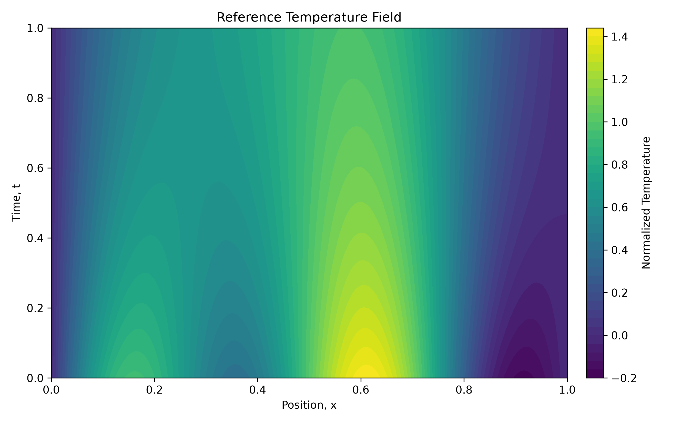

## 3.5 Sparse Measurements

Temperature is measured only at selected spatial sensor locations.

Four sensor configurations were investigated:

| Sensors \(N_s\) | Sparsity \(S\) | Difficulty |
|---:|---:|---|
| 16 | 1 | Low |
| 8 | 2 | Moderate |
| 4 | 4 | High |
| 2 | 8 | Very High |

The measurement-sparsity parameter is

$$S=\frac{16}{N_s}.$$

Therefore,

$$S\in\{1,2,4,8\}.$$

Increasing \(S\) corresponds to fewer available spatial measurements.

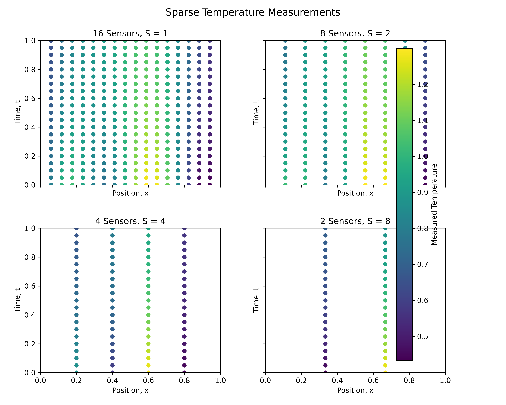

## 3.6 PINN Architecture

The PINN receives the spatial coordinate \(x\) and time \(t\) as inputs and predicts

$$T_\theta(x,t).$$

The network contains three hidden layers with 64 neurons per layer and hyperbolic-tangent activation functions.

The model was trained using Adam with a learning rate of

$$10^{-3}$$

for 3000 epochs.

A total of 2000 randomly distributed PDE collocation points were used.

## 3.7 PINN Loss Function

The PINN objective contains four components:

$$L=L_{\text{PDE}}+L_{\text{BC}}+L_{\text{IC}}+L_{\text{data}}.$$

The PDE loss enforces

$$\frac{\partial T_\theta}{\partial t}-\alpha\frac{\partial^2T_\theta}{\partial x^2}=0.$$

The data loss is

$$L_{\text{data}}=\frac{1}{N_m}\sum_{i=1}^{N_m}|T_\theta(x_i,t_i)-T_i|^2.$$

Boundary losses enforce

$$T_\theta(0,t)=0$$

and

$$T_\theta(1,t)=0.$$

Initial-condition measurements were tracked separately using \(L_{\text{IC}}\).

All four terms were initially given equal weight.

## 3.8 Project Path

This project follows **Path B: Diagnosis**.

The central research question is:

> How does measurement sparsity affect the ability of a PINN to reconstruct a transient physical field, and what mechanism causes reconstruction failure when measurements become extremely sparse?

---

# 4. Numerical Experiments

## 4.1 P1 — Conventional Baseline

A conventional spectral inverse solver was implemented as a baseline.

The heat-equation solution was represented using a Fourier sine expansion,

$$T(x,t)=\sum_{n=1}^{N}a_n\sin(n\pi x)e^{-\alpha(n\pi)^2t}.$$

Twelve spectral modes were retained.

The sparse measurements produce the linear inverse problem

$$A\mathbf{a}=\mathbf{y}.$$

The coefficients were reconstructed using regularized least squares,

$$\hat{\mathbf{a}}=(A^TA+\lambda I)^{-1}A^T\mathbf{y},$$

with

$$\lambda=10^{-8}.$$

The conventional solver used exactly the same sparse measurements provided to the PINN.

Reconstruction accuracy was measured using relative \(L^2\) error,

$$\text{Relative }L^2\text{ Error}=\frac{\|T_{\text{pred}}-T_{\text{true}}\|_2}{\|T_{\text{true}}\|_2}.$$

### Baseline and PINN Results

| Sensors | \(S\) | PINN Error | Spectral Baseline Error | Condition Number |
|---:|---:|---:|---:|---:|
| 16 | 1 | 0.1684% | \(7.73\times10^{-9}\%\) | \(3.80\) |
| 8 | 2 | 0.3955% | \(1.46\times10^{-8}\%\) | \(3.14\times10^{15}\) |
| 4 | 4 | 4.2400% | \(2.15\times10^{-7}\%\) | \(2.04\times10^{16}\) |
| 2 | 8 | 23.6962% | \(8.95\times10^{-6}\%\) | \(2.36\times10^{19}\) |

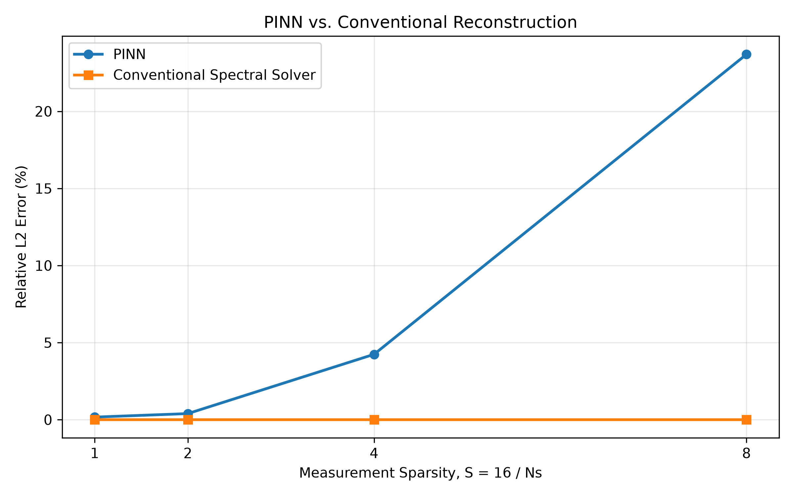

The conventional spectral method remained extremely accurate in the noise-free test even at very high sparsity.

However, this should not be interpreted as evidence that the inverse problem remains well-conditioned.

The condition number increased dramatically as measurements were removed.

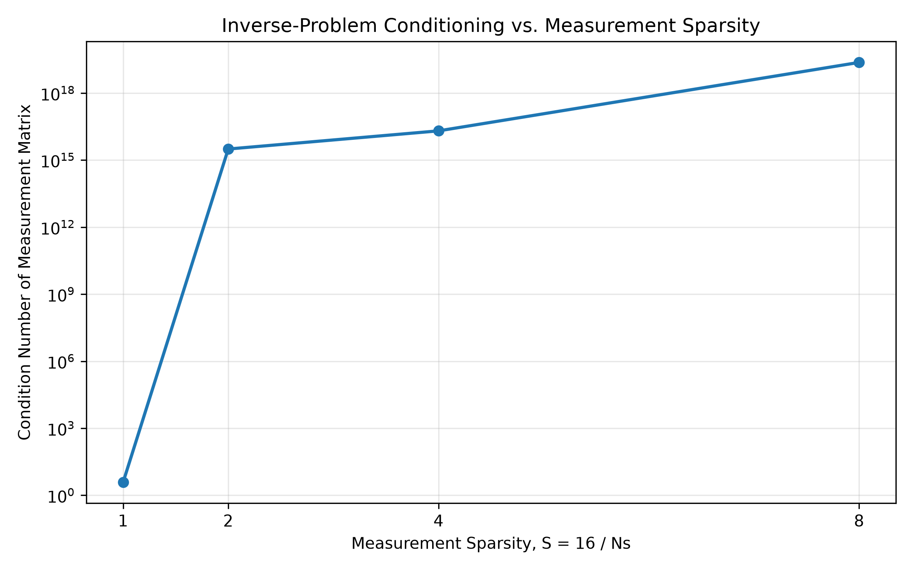

At 16 sensors,

$$\kappa(A)\approx3.8,$$

while at 2 sensors,

$$\kappa(A)\approx2.36\times10^{19}.$$

The inverse problem therefore becomes extremely sensitive as spatial measurements are removed.

The spectral solver remains accurate because the synthetic data are noise-free and the true field is exactly represented by the spectral basis used in the conventional model.

This represents a highly favorable condition for the conventional solver.

---

## 4.2 P2 — PINN Loss Components

The PDE, boundary, initial-condition, measurement, and total losses were tracked independently throughout training.

For the 16-sensor case, all major loss components decreased by several orders of magnitude.

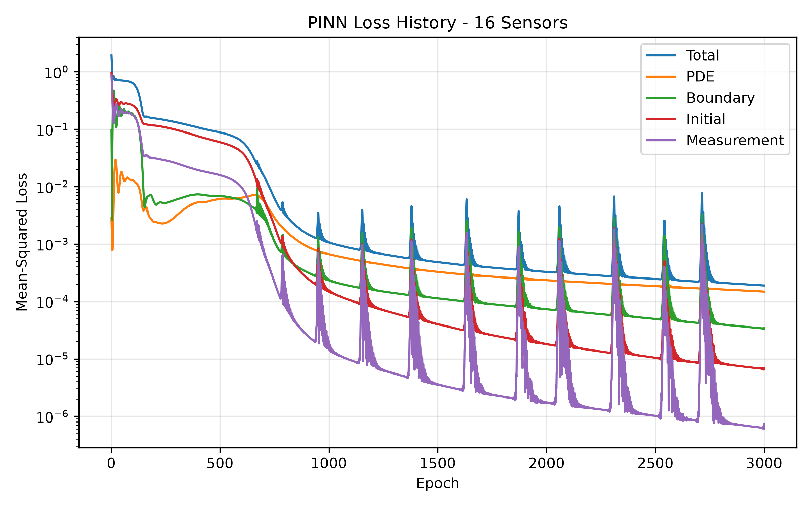

The 16-sensor PINN produced a relative \(L^2\) error of approximately

$$0.001684,$$

or

$$0.1684\%.$$

This demonstrates that the chosen architecture and training procedure are capable of accurately reconstructing the field when sufficient spatial measurements are available.

The loss history contains periodic temporary increases, but the overall optimization trend remains strongly downward and the final reconstruction error is low.

For comparison, the loss behavior of the most sparse case was also recorded:

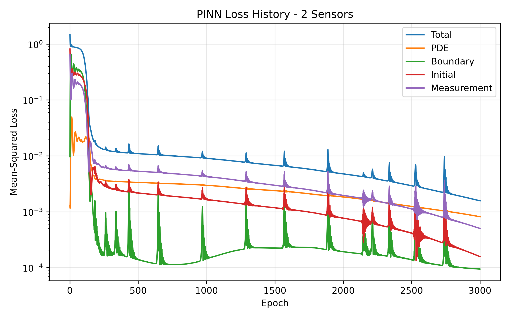

These loss histories are important because a small training loss does not necessarily imply that the complete unobserved field has been reconstructed correctly.

---

## 4.3 P3 — Error Versus Measurement Sparsity

The PINN was independently trained using 16, 8, 4, and 2 spatial sensors.

The resulting errors were:

| Sensors | Sparsity \(S\) | Relative \(L^2\) Error |
|---:|---:|---:|
| 16 | 1 | 0.1684% |
| 8 | 2 | 0.3955% |
| 4 | 4 | 4.2400% |
| 2 | 8 | 23.6962% |

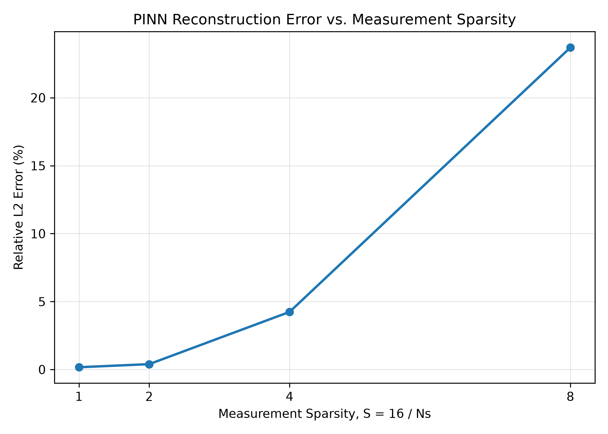

The reconstruction error remains below 0.4% between the 16- and 8-sensor cases.

A much larger increase occurs when the number of sensors is reduced to four.

The most severe degradation occurs between four and two sensors:

$$4.24\%\rightarrow23.70\%.$$

This identifies a clear sparse-data failure regime.

The experiment therefore reproduces one of the main concerns identified by the researcher: a physics-informed model can satisfy available measurements and physics constraints while still reconstructing the complete field poorly when observations become too sparse.

---

## 4.4 P4 — Spatial and Spectral Error Analysis

### Spatial Error

The 16-sensor reconstruction closely matches the true temperature field.

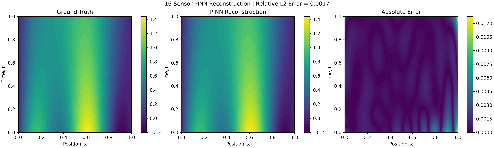

The 2-sensor reconstruction shows a much larger error:

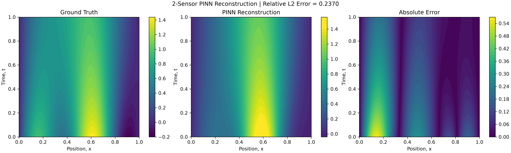

The failure is therefore not limited to the measured sensor locations. Significant errors occur throughout unobserved portions of the domain.

### Fourier Analysis

The analytical initial field contains only two intended sine modes:

$$T(x,0)=\sin(\pi x)+0.5\sin(4\pi x).$$

Therefore the true spectrum contains:

- mode 1 with amplitude approximately 1.0,
- mode 4 with amplitude approximately 0.5,
- approximately zero amplitude at the other modes.

The Fourier analysis of the 2-sensor PINN shows a different pattern.

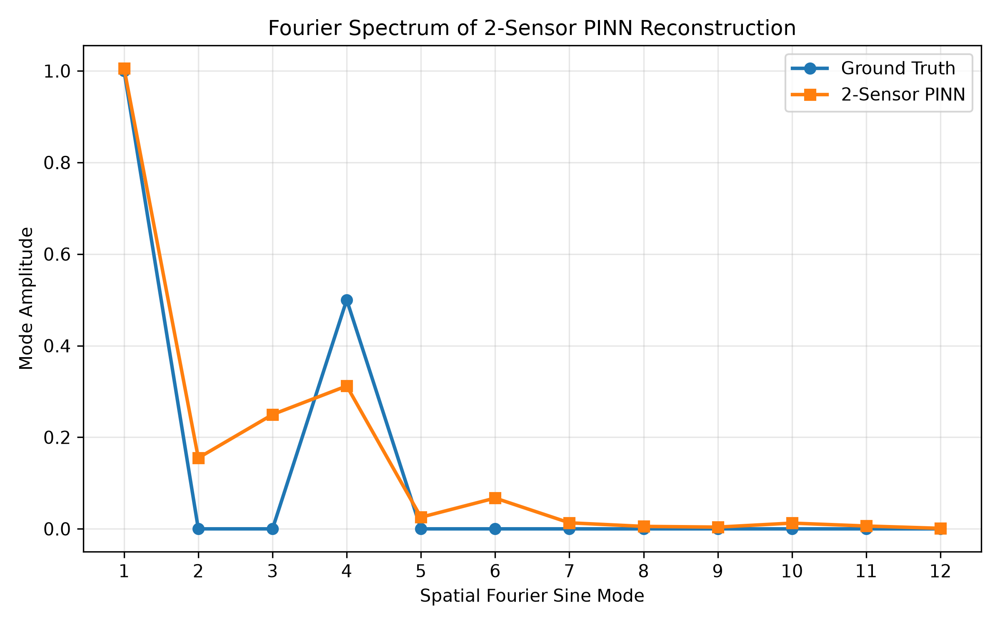

The PINN retains the dominant first mode relatively well.

However, the fourth mode is substantially underestimated, falling from the true amplitude of approximately 0.50 to roughly 0.31.

The reconstructed field also contains nonphysical energy in modes that should be approximately zero, particularly modes 2 and 3 and smaller contributions at additional modes.

This indicates two related failure mechanisms:

1. **loss of higher-frequency information**, and
2. **spectral leakage into incorrect spatial modes**.

The result suggests that the sparse-data PINN primarily preserves the dominant large-scale structure while struggling to reconstruct smaller-scale spatial information.

This behavior is consistent with spectral bias commonly observed in neural-network approximation, where lower-frequency structures are often learned more easily than higher-frequency structures.

For this project, measurement sparsity makes this limitation substantially more visible.

---

## 4.5 P5 — Computational Cost

PINN training, PINN inference, and conventional reconstruction runtimes were recorded.

| Sensors | PINN Training | PINN Inference | Conventional Reconstruction |
|---:|---:|---:|---:|
| 16 | 63.88 s | 0.0358 s | 0.0139 s |
| 8 | 52.46 s | 0.0235 s | 0.0060 s |
| 4 | 52.16 s | 0.0199 s | 0.0058 s |
| 2 | 51.70 s | 0.0182 s | 0.0089 s |

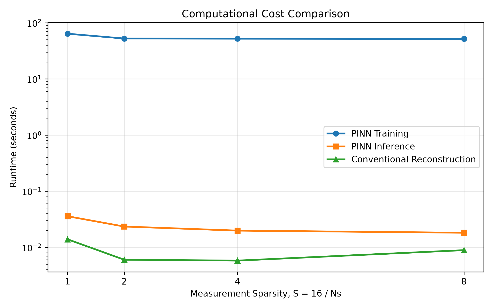

PINN training required approximately 52-64 seconds for these small experiments.

Once trained, PINN inference required only approximately

$$0.018-0.036\text{ s}.$$

The conventional spectral reconstruction required approximately

$$0.006-0.014\text{ s}.$$

For this simple problem, the conventional method is therefore both more accurate and less computationally expensive.

The major potential advantage of the PINN is not demonstrated by this single small problem.

A PINN could become more attractive when a trained representation is reused many times, when the geometry or physics makes a conventional inverse solve substantially more expensive, or when measurements and physical constraints must be combined in a form that is difficult to express using a simple spectral basis.

**Hardware:** Experiments were performed in the GitHub Codespaces environment using the computing device automatically selected by PyTorch.  
**Before submission, replace this sentence with the actual device printed by the script if available.**

---

# 5. Results and Discussion

## 5.1 Main Finding

The central finding is that measurement sparsity strongly affects PINN reconstruction accuracy.

The PINN performed very well when sufficient spatial measurements were available:

$$0.1684\%\text{ error at 16 sensors}$$

and

$$0.3955\%\text{ error at 8 sensors}.$$

Accuracy deteriorated substantially as spatial information was removed:

$$4.2400\%\text{ error at 4 sensors}$$

and

$$23.6962\%\text{ error at 2 sensors}.$$

The relationship is strongly nonlinear. Removing measurements eventually causes a rapid transition from accurate reconstruction to major field error.

## 5.2 Is the Failure Caused Only by Lack of Information?

The conventional spectral baseline helps answer this question.

At two sensors, the PINN produced approximately

$$23.70\%\text{ error},$$

while the spectral solver remained essentially exact in the idealized test.

Therefore, the PINN failure cannot be attributed solely to complete loss of information.

Under the assumptions of this experiment, enough information remained to identify the correct spectral solution.

Instead, the evidence points toward a limitation of the PINN's training and representation under extremely sparse spatial observations.

## 5.3 Why the Baseline Remains Accurate Despite Poor Conditioning

The measurement matrix becomes severely ill-conditioned as sensor sparsity increases.

At two sensors,

$$\kappa(A)\approx2.36\times10^{19}.$$

Normally, such a large condition number would make the inverse solution extremely sensitive to noise and perturbations.

The conventional solver nevertheless remains accurate here because:

1. the measurements contain no synthetic noise,
2. the governing model exactly matches the generated data,
3. the true field is composed of modes already contained in the spectral basis,
4. a small regularization term is applied.

The baseline therefore represents an idealized best-case conventional solver.

Experimental data containing camera noise, model mismatch, turbulence, uncertain parameters, or other real-world disturbances would likely make the conditioning problem substantially more important.

## 5.4 Failure Mechanism

The Fourier analysis provides the clearest mechanistic explanation.

The 2-sensor PINN accurately captures the dominant low-frequency first mode but substantially underestimates the higher-frequency fourth mode.

It also produces spectral components that are not present in the true field.

The failure can therefore be summarized as

$$\text{sparse measurements}\rightarrow\text{loss of high-frequency information}+\text{spectral leakage}.$$

The PINN preserves the broad structure of the solution but increasingly loses smaller-scale spatial details.

This mechanism is particularly relevant to the researcher's real application because refractive-index fields produced by airflow and turbulence may contain spatial structures over many different length scales.

---

# 6. Recommendation Memo to Researcher

## To: [Researcher Name]

## Subject: PINN Viability for Sparse Physical-Field Reconstruction

The classroom study examined whether a physics-informed neural network could reconstruct a transient physical field from sparse measurements while enforcing a governing PDE.

A one-dimensional heat-equation problem was used as a simplified analogue of the sparse-field reconstruction problem discussed during the interview.

The most important result was that the PINN performed extremely well when sufficient spatial measurements were available but degraded rapidly when measurements became very sparse.

The relative reconstruction error increased from approximately 0.17% with 16 sensors to approximately 23.7% with only two sensors.

A conventional spectral inverse solver remained essentially exact on the same noise-free synthetic data. This indicates that the PINN failure was not caused only by a complete lack of information in the measurements.

Fourier analysis showed that the sparse PINN continued to reproduce the dominant large-scale spatial mode but substantially underestimated a higher-frequency component and introduced several incorrect modes.

This suggests that sparse measurements make smaller-scale spatial structures particularly difficult for the PINN to recover.

For the full refractive-index reconstruction problem, I would therefore recommend using PINNs cautiously rather than replacing the existing conventional reconstruction method outright.

PINNs appear promising when:

- moderate measurement coverage is available,
- the governing physics are well known,
- repeated inference is required after training,
- conventional representations are difficult to construct,
- physically constrained interpolation between measurements is valuable.

However, additional validation is particularly important when measurements become extremely sparse.

For the researcher's application, useful next experiments would include:

- adding realistic measurement noise,
- increasing spatial frequency or turbulence-like content,
- testing adaptive or weighted PINN losses,
- adding additional measurement views,
- testing Fourier-feature or multiscale neural architectures,
- comparing against the existing differentiable-rendering reconstruction method.

The strongest conclusion from this study is that a PINN can reconstruct a sparse physical field very accurately under moderate measurement sparsity, but the presence of a low training loss alone is not sufficient evidence that the complete field has been reconstructed correctly.

Spectral and full-field validation are therefore recommended whenever PINNs are used for highly under-observed inverse problems.

---

# 7. Assumptions and Limitations

The classroom model intentionally simplifies the researcher's full problem.

Major assumptions and limitations include:

- the physical domain is one-dimensional rather than three-dimensional,
- the system uses the heat equation instead of full Navier-Stokes dynamics,
- optical ray tracing is excluded,
- turbulence is excluded,
- measurements are synthetic,
- measurements contain no noise,
- thermal diffusivity is known and constant,
- boundary conditions are exactly known,
- the forward physical model exactly matches the generated data,
- all sensor measurements are perfectly calibrated,
- the spectral baseline contains the same Fourier family used to generate the true solution,
- only one neural-network architecture was examined,
- all PINN loss terms initially use equal weighting,
- only one primary random seed was used for the reported sweep,
- no uncertainty quantification was performed.

The absence of noise is particularly important.

The condition number of the conventional inverse problem becomes extremely large under sparse measurements, indicating that even small measurement perturbations could strongly affect a real reconstruction.

The near-zero baseline error should therefore be interpreted as a best-case result rather than proof that the sparse inverse problem is stable.

---

# 8. Conclusions

This project investigated sparse physical-field reconstruction using a physics-informed neural network.

The work was motivated by a research problem involving reconstruction of three-dimensional time-varying refractive-index fields from limited camera measurements.

The real problem was reduced to reconstruction of a transient one-dimensional temperature field from sparse measurements while enforcing the heat equation.

The main results are:

1. The PINN accurately reconstructed the field with 16 sensors, achieving approximately **0.168% relative \(L^2\) error**.

2. Reconstruction remained strong at 8 sensors with approximately **0.396% error**.

3. Error increased substantially to approximately **4.24% at 4 sensors**.

4. At only 2 sensors, PINN error increased to approximately **23.70%**.

5. The conventional spectral solver remained essentially exact in the idealized noise-free problem.

6. The measurement matrix became extremely ill-conditioned, reaching approximately **\(2.36\times10^{19}\)** at two sensors.

7. Fourier analysis showed that the sparse PINN retained the dominant low-frequency structure but substantially underestimated the higher-frequency fourth mode and introduced incorrect spatial modes.

The Path B diagnosis is therefore:

$$\boxed{\text{Extreme measurement sparsity exposes a PINN representation/training failure, particularly for higher-frequency spatial information.}}$$

The experiment supports the researcher's concern that a model can agree with limited measurements and known physics while still producing an inaccurate complete field.

For real sparse-camera reconstruction problems, PINNs therefore appear most promising when combined with careful full-field validation, spectral analysis, appropriate measurement coverage, and methods designed to improve multiscale reconstruction.

---

# 9. Reproducibility and Repository Files

The numerical study is implemented using the following files:

### `project3_pinn.py`

Defines:

- analytical heat-equation solution,
- sparse measurements,
- PINN architecture,
- PDE residual,
- training procedure,
- reconstruction figures,
- loss-history figures.

### `project3_sweep.py`

Runs the PINN for:

- 16 sensors,
- 8 sensors,
- 4 sensors,
- 2 sensors.

It generates:

- error-versus-sparsity results,
- training times,
- individual loss histories,
- individual reconstruction plots.

### `project3_baseline.py`

Implements:

- conventional spectral inverse solver,
- regularized least squares,
- conditioning analysis,
- PINN-versus-baseline comparison.

### `project3_finalize.py`

Generates:

- Fourier-spectrum analysis,
- final runtime comparison,
- combined numerical summary.

### Numerical Output Files

- `project3_sensor_sweep.csv`
- `project3_baseline_results.csv`
- `project3_combined_summary.csv`
- `project3_pinn_2_prediction.npy`

### Main Commands

```bash
python project3_pinn.py
python project3_sweep.py
python project3_baseline.py
python project3_finalize.py
```

---

# 10. Final Project Summary

The complete workflow is

$$\text{researcher problem}\rightarrow\text{minimal PDE model}\rightarrow\text{sparse measurements}\rightarrow\text{PINN reconstruction}\rightarrow\text{failure sweep}\rightarrow\text{baseline comparison}\rightarrow\text{spectral diagnosis}.$$

The simplified model does not reproduce the researcher's full optical reconstruction system, but it preserves the central inverse-problem challenge identified during the interview.

The results demonstrate both the potential and the limitations of physics-informed neural networks for reconstruction from sparse physical measurements.
