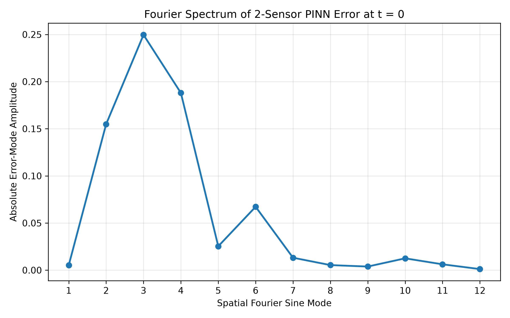
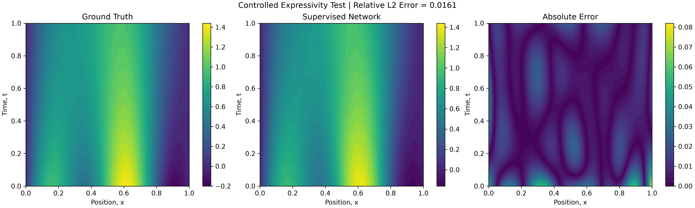
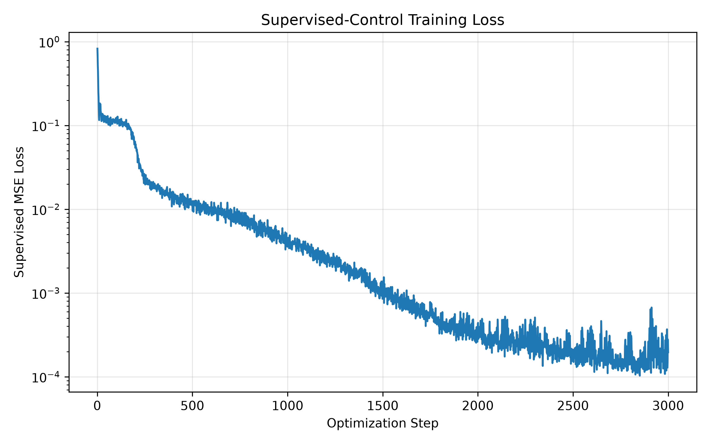

# Project III: Diagnosing PINN Failure in Sparse-Data Field Reconstruction

## Sparse-Data Reconstruction of a Transient Heat Field Using a Physics-Informed Neural Network

---

## 1.1 Outreach Log

| Item | Information |
|---|---|
| Researcher | **Omkar Shailendra** |
| Position | **Graduate Research Assistant and Ph.D. Student in Computer Engineering** |
| Institution | **Arizona State University** |
| How Researcher Was Found | **Identified and contacted through LinkedIn** |
| Initial Contact Method | LinkedIn |
| Interview Communication | Email |
| Interview Format | Asynchronous written interview by email |
| Interview Completed | **October 20, 2026** |
| Outcome | Substantive written responses received |
| Problem-Brief Review | Follow-up confirmation requested |

Omkar Shailendra was identified through LinkedIn while searching for an Arizona State University researcher working on computational and physics-based reconstruction problems. Initial outreach was conducted through LinkedIn.

Because scheduling did not allow for a live meeting, the interview was later completed asynchronously through email. Omkar provided substantive written responses concerning his current research problem, governing equations, computational methods, limitations, current use of physics-informed approaches, and possible simplified problems appropriate for a classroom physics-informed neural network study.

## 1.2 Interview Summary

The researcher's current work focuses on reconstructing **three-dimensional, time-varying refractive-index fields** from a limited number of camera measurements. Refractive-index variations can be caused by physical phenomena including heat transfer, airflow, and turbulence.

The goal is to make otherwise transparent physical phenomena measurable in three dimensions.

The governing physics can involve:

- Navier-Stokes equations,
- conservation of mass,
- energy conservation,
- advection-diffusion equations,
- relationships between temperature, density, and refractive index,
- optical ray propagation.

Current reconstruction methods include:

- differentiable rendering,
- ray tracing,
- gradient-based optimization,
- GPU-based computation.

For large three-dimensional or time-dependent systems, reconstruction may require thousands of optimization iterations.

The researcher identified the **limited number of measurements and the ill-posed nature of the inverse problem** as a primary challenge. A complete three-dimensional field must be estimated using only a limited number of two-dimensional observations.

Several additional limitations of physics-informed neural networks and related methods were identified:

- sparse measurements may permit multiple possible solutions,
- matching measurements does not guarantee that the entire field is physically correct,
- balancing different loss terms may be difficult,
- initialization can affect training,
- training may require substantial computational effort.

For a reduced classroom problem, the researcher recommended preserving the **inverse-problem and limited-data characteristics** rather than attempting to reproduce full three-dimensional turbulent flow.

A two-dimensional heat or advection-diffusion problem was suggested as an appropriate simplified problem. The present study reduced the problem even further to one spatial dimension while maintaining the sparse inverse-reconstruction challenge.

---

# 2. Problem Brief

## 2.1 Real Research Problem

The research problem can be represented conceptually as

$$\text{sparse camera observations}\rightarrow\text{unknown time-dependent 3D physical field}.$$

Because the number of measurements is much smaller than the number of unknown field values, the reconstruction is an inverse problem.

Known physical equations provide information that is not directly contained in the measurements. Physics-informed approaches attempt to use these governing equations to constrain the possible reconstructed fields.

## 2.2 Governing Physics

A transported temperature-like scalar may be described by the general advection-diffusion equation

$$\frac{\partial T}{\partial t}+\mathbf{u}\cdot\nabla T=\alpha\nabla^2T.$$

where:

- \(T\) is the transported scalar field,
- \(\mathbf{u}\) is the velocity field,
- \(\alpha\) is the diffusion coefficient.

The researcher's complete problem may additionally involve conservation of mass, Navier-Stokes equations, and an optical forward model relating the reconstructed physical field to camera measurements.

## 2.3 Current Computational Approach

The current research approach uses differentiable rendering, ray tracing, and gradient-based optimization.

A physics-based forward model predicts what camera measurements should be produced by a candidate physical field. The field representation is then modified iteratively until simulated measurements agree with experimental observations.

For large three-dimensional and time-dependent problems, this reconstruction may require thousands of optimization iterations.

The problem must also often be solved repeatedly for different:

- time steps,
- camera arrangements,
- measurement sets,
- experimental conditions,
- physical parameters.

## 2.4 Primary Computational Challenge

The primary difficulty identified during the interview is **measurement sparsity and the resulting ill-posed inverse problem**.

Conceptually,

$$\text{fewer measurements}\rightarrow\text{greater reconstruction ambiguity}.$$

A reconstruction may potentially reproduce available measurements while remaining incorrect in regions that were never observed.

A governing PDE provides additional information that may reduce this ambiguity.

## 2.5 Role of Physics-Informed Machine Learning

A physics-informed neural network represents the unknown field using a neural network while simultaneously penalizing violations of the governing physical equation.

Conceptually,

$$\text{sparse measurements}+\text{governing physics}\rightarrow\text{full-field reconstruction}.$$

PINNs are therefore potentially attractive when measurements are expensive or difficult to obtain but the governing equations are known.

---

# 3. Minimal Problem Formulation

## 3.1 Simplification of the Research Problem

The complete three-dimensional refractive-index problem would require fluid dynamics, optical ray tracing, camera models, and a large three-dimensional reconstruction.

The project was therefore reduced to a **one-dimensional transient heat-equation inverse problem**.

The simplified problem is

$$\text{sparse temperature measurements}\rightarrow\text{reconstruction of the complete }T(x,t)\text{ field}.$$

Although the geometry and physics are considerably simpler, the primary difficulty identified by the researcher is preserved:

> Reconstruct a complete physical field from limited measurements while enforcing known physics.

A PINN was selected rather than a neural operator because this project investigates reconstruction of a single physical system from sparse measurements rather than learning an operator across a large family of PDE solutions.

## 3.2 Governing Equation

The system is governed by the one-dimensional transient heat equation,

$$\frac{\partial T}{\partial t}=\alpha\frac{\partial^2T}{\partial x^2}.$$

The domain is

$$0\leq x\leq1$$

and

$$0\leq t\leq1.$$

The thermal diffusivity is

$$\alpha=0.01.$$

The field \(T\) is interpreted as a **normalized temperature deviation** rather than an absolute temperature.

## 3.3 Boundary Conditions

Homogeneous Dirichlet boundary conditions are used:

$$T(0,t)=0,$$

$$T(1,t)=0.$$

## 3.4 Reference Solution

The initial normalized temperature field is

$$T(x,0)=\sin(\pi x)+0.5\sin(4\pi x).$$

The analytical heat-equation solution is

$$T(x,t)=\sin(\pi x)e^{-\alpha\pi^2t}+0.5\sin(4\pi x)e^{-16\alpha\pi^2t}.$$

The solution deliberately includes both a low-frequency and a higher-frequency spatial component.

The analytical field is used only to:

- generate synthetic measurements,
- evaluate reconstruction accuracy,
- identify where reconstruction failure occurs.

The PINN is not given the complete analytical solution during sparse-data training.


## 3.5 Measurement Sparsity

The number of available spatial sensors was varied as the primary difficulty parameter.

| Sensors \(N_s\) | Sparsity \(S\) | Difficulty |
|---:|---:|---|
| 16 | 1 | Low |
| 8 | 2 | Moderate |
| 4 | 4 | High |
| 2 | 8 | Very High |

The measurement-sparsity parameter is

$$S=\frac{16}{N_s}.$$

Therefore,

$$S\in\{1,2,4,8\}.$$


## 3.6 PINN Architecture

The neural network receives \(x\) and \(t\) as inputs and predicts

$$T_\theta(x,t).$$

The network contains:

- 2 inputs,
- three hidden layers,
- 64 neurons per hidden layer,
- hyperbolic-tangent activation functions,
- 1 scalar output.

The model was trained using Adam with learning rate

$$10^{-3}$$

for 3000 epochs.

A total of 2000 PDE collocation points were used.

## 3.7 PINN Objective

The PINN loss is

$$L=L_{\text{PDE}}+L_{\text{BC}}+L_{\text{IC}}+L_{\text{data}}.$$

The PDE term enforces

$$\frac{\partial T_\theta}{\partial t}-\alpha\frac{\partial^2T_\theta}{\partial x^2}=0.$$

The measurement loss is

$$L_{\text{data}}=\frac{1}{N_m}\sum_{i=1}^{N_m}|T_\theta(x_i,t_i)-T_i|^2.$$

Boundary losses enforce

$$T_\theta(0,t)=0$$

and

$$T_\theta(1,t)=0.$$

Initial-condition measurements were monitored separately using \(L_{\text{IC}}\).

All four loss terms initially received equal weight.

## 3.8 Project Path

This project follows **Path B: Diagnosis**.

The primary question is:

> How does measurement sparsity affect PINN field reconstruction, and what mechanism causes reconstruction failure when measurements become extremely sparse?

---

# 4. Numerical Experiments

# 4.1 P1 — Conventional Baseline

A conventional spectral inverse solver was implemented as a physics-based comparison.

The heat-equation solution was represented as

$$T(x,t)=\sum_{n=1}^{N}a_n\sin(n\pi x)e^{-\alpha(n\pi)^2t}.$$

Twelve sine modes were retained.

Sparse measurements produce the linear inverse problem

$$A\mathbf{a}=\mathbf{y}.$$

The coefficients were reconstructed using regularized least squares:

$$\hat{\mathbf{a}}=(A^TA+\lambda I)^{-1}A^T\mathbf{y},$$

with

$$\lambda=10^{-8}.$$

The spectral solver received the same sparse measurements as the PINN.

Accuracy was measured using relative \(L^2\) error:

$$\text{Relative }L^2\text{ Error}=\frac{\|T_{\text{pred}}-T_{\text{true}}\|_2}{\|T_{\text{true}}\|_2}.$$

## Baseline Results

| Sensors | \(S\) | PINN Error | Spectral Error | Condition Number |
|---:|---:|---:|---:|---:|
| 16 | 1 | 0.1684% | \(7.73\times10^{-9}\%\) | \(3.80\) |
| 8 | 2 | 0.3955% | \(1.46\times10^{-8}\%\) | \(3.14\times10^{15}\) |
| 4 | 4 | 4.2400% | \(2.15\times10^{-7}\%\) | \(2.04\times10^{16}\) |
| 2 | 8 | 23.6962% | \(8.95\times10^{-6}\%\) | \(2.36\times10^{19}\) |


The conventional spectral solver remained essentially exact in the idealized noise-free problem.

However, the conditioning analysis shows that the inverse problem becomes increasingly fragile as sensors are removed.


At 16 sensors,

$$\kappa(A)\approx3.80,$$

while at 2 sensors,

$$\kappa(A)\approx2.36\times10^{19}.$$

The spectral solver remains accurate because:

- measurements are noise-free,
- the physical model exactly matches the generated data,
- the true field lies directly within the chosen spectral basis,
- a small regularization term is used.

This represents a favorable best-case baseline.

---

# 4.2 P2 — PINN Loss Components

The total, PDE, boundary, initial-condition, and measurement losses were recorded separately during training.


For 16 sensors, all major losses decreased substantially and the final field error was only

$$0.1684\%.$$

This demonstrates that the architecture and optimization procedure can accurately reconstruct the field when sufficient spatial measurements are available.

The most sparse case was also monitored:


The important observation is that decreasing individual training losses does not guarantee that the complete unobserved field has been reconstructed correctly.

---

# 4.3 P3 — Reconstruction Error Versus Measurement Sparsity

The PINN was independently trained using each sensor configuration.

| Sensors | \(S\) | Relative \(L^2\) Error |
|---:|---:|---:|
| 16 | 1 | 0.1684% |
| 8 | 2 | 0.3955% |
| 4 | 4 | 4.2400% |
| 2 | 8 | 23.6962% |


The PINN remains extremely accurate between 16 and 8 sensors.

Accuracy then deteriorates rapidly:

$$0.3955\%\rightarrow4.2400\%\rightarrow23.6962\%.$$

The transition between four and two sensors is particularly severe.

This establishes a clear sparse-measurement failure regime.

---

# 4.4 P4 — Spatial and Spectral Error Analysis

## Spatial Error

The 16-sensor solution closely reproduces the analytical field.


With only two sensors, much larger errors appear throughout the unobserved portions of the domain.


## Fourier Analysis of the Reconstructed Field

The true initial field contains two intended sine modes:

$$T(x,0)=\sin(\pi x)+0.5\sin(4\pi x).$$

Therefore:

$$a_1=1$$

and

$$a_4=0.5.$$

The 2-sensor PINN retains the first mode relatively well but substantially underestimates the fourth mode and introduces energy into modes that should be approximately zero.


## Fourier Spectrum of the Error

The required error spectrum was also computed directly from

$$e(x,0)=T_\theta(x,0)-T_{\text{true}}(x,0).$$



The mode-1 error amplitude is only approximately

$$0.0053,$$

while the mode-4 error amplitude is approximately

$$0.1880.$$

Therefore the reconstruction error is much more strongly concentrated in the higher-frequency fourth mode than in the dominant first mode.

This provides evidence that the sparse PINN preserves the broad low-frequency structure much better than the smaller-scale spatial structure.

---

# 4.5 P5 — Computational Cost

Runtime was measured for PINN training, PINN inference, and the conventional spectral reconstruction.

| Sensors | PINN Training | PINN Inference | Spectral Reconstruction |
|---:|---:|---:|---:|
| 16 | 63.88 s | 0.0358 s | 0.0139 s |
| 8 | 52.46 s | 0.0235 s | 0.0060 s |
| 4 | 52.16 s | 0.0199 s | 0.0058 s |
| 2 | 51.70 s | 0.0182 s | 0.0089 s |


PINN training requires approximately 52-64 seconds.

Once trained, inference requires approximately

$$0.018-0.036\text{ s}.$$

The conventional spectral solver requires only approximately

$$0.006-0.014\text{ s}.$$

For this simplified problem, the conventional solver is therefore both faster and more accurate.

PINNs may become more attractive for substantially more complicated systems, especially when a trained representation can be reused many times.

---

# 5. Path B Controlled Diagnosis

The sensor-sparsity sweep demonstrated failure but did not by itself establish whether the cause was:

1. insufficient neural-network expressive capacity, or
2. the sparse physics-informed training process.

A controlled experiment was therefore performed.

The **same neural-network architecture** used by the PINN was trained using ordinary supervised regression on reference-field samples.

No PDE residual was used in this control experiment.

If the network architecture itself were incapable of representing the solution, supervised training should also produce a large error.

## 5.1 Controlled Experiment Result

The 2-sensor PINN produced:

$$\boxed{23.6962\%\text{ error}}.$$

The same neural-network architecture trained directly on reference data produced:

$$\boxed{1.6056\%\text{ error}}.$$



The supervised control training required approximately

$$5.31\text{ s}.$$



The same architecture therefore performs dramatically better when directly provided representative field information.

The error was reduced by approximately a factor of

$$\frac{23.6962}{1.6056}\approx14.8.$$

This demonstrates that **network expressivity alone does not explain the sparse PINN failure**.

The dominant difficulty is instead associated with the sparse physics-informed training problem.

---

# 6. Results and Discussion

## 6.1 Main Finding

Measurement sparsity strongly affects PINN reconstruction accuracy.

The PINN performs extremely well at moderate measurement density:

$$0.1684\%\text{ error at 16 sensors}$$

and

$$0.3955\%\text{ error at 8 sensors}.$$

Performance deteriorates substantially at four sensors and becomes poor at only two sensors:

$$4.2400\%\text{ error at 4 sensors},$$

$$23.6962\%\text{ error at 2 sensors}.$$

The relationship is therefore strongly nonlinear.

## 6.2 Is the Failure Simply Caused by Lack of Information?

The conventional spectral baseline remained essentially exact even with two sensors in the idealized problem.

Therefore the PINN failure cannot be explained only by complete loss of information.

Under the assumptions of this experiment, sufficient information remained to recover the intended spectral solution.

However, the extremely large condition number demonstrates that the problem is becoming increasingly sensitive and would likely behave very differently in the presence of noise or model mismatch.

## 6.3 Is the Neural Network Incapable of Representing the Solution?

The supervised control experiment answers this question.

Using exactly the same neural-network architecture:

- sparse PINN error = **23.6962%**,
- supervised error = **1.6056%**.

The architecture is therefore capable of representing the field much more accurately than the sparse PINN result suggests.

This rules out limited network expressivity as the primary explanation.

## 6.4 Diagnosed Failure Mechanism

The combined evidence supports the following mechanism:

$$\boxed{\text{sparse spatial measurements}\rightarrow\text{weak information about high-frequency structure}\rightarrow\text{PINN training converges to an inaccurate full field}}.$$

The first spatial mode is reproduced accurately, while the fourth mode contains much larger error.

The PINN therefore preserves the dominant large-scale structure but struggles to infer smaller spatial structures when measurement locations become extremely sparse.

The supervised control experiment shows that this is primarily a **training/information constraint in the physics-informed inverse problem**, rather than a fundamental inability of the neural network to represent the true solution.

This directly supports the concern raised during the researcher interview that a model may match sparse observations and satisfy physics constraints without accurately reconstructing the complete physical field.

---

# 7. Recommendation Memo to Researcher

## To: Omkar Shailendra

## Subject: PINN Viability for Sparse Physical-Field Reconstruction

This project investigated whether a physics-informed neural network could reconstruct a transient physical field from sparse measurements while enforcing a governing PDE.

A one-dimensional heat-equation problem was used as a simplified analogue of the sparse-field reconstruction problem discussed during our email interview.

The PINN performed very well when sufficient measurements were available. Relative reconstruction error was approximately 0.17% with 16 sensors and 0.40% with eight sensors.

Performance degraded rapidly as spatial observations became sparse. Error increased to approximately 4.24% with four sensors and 23.70% with only two sensors.

A conventional spectral reconstruction remained essentially exact on the same idealized noise-free measurements. A controlled experiment using the same neural-network architecture with ordinary supervised training reduced error from 23.70% to approximately 1.61%.

This indicates that the neural-network architecture itself is capable of representing the solution. The severe sparse-PINN error is instead primarily associated with the sparse physics-informed training problem.

Fourier analysis provided an additional explanation. The two-sensor PINN accurately reproduced the dominant first spatial mode but showed an error amplitude of approximately 0.188 in the higher-frequency fourth mode compared with only approximately 0.005 in the first mode.

This suggests that sparse measurements make smaller-scale spatial information particularly difficult for the PINN to recover.

For the full refractive-index reconstruction problem, I would therefore recommend using PINNs as a complementary reconstruction tool rather than replacing the existing physics-based reconstruction framework outright.

They appear most promising when:

- moderate measurement coverage is available,
- governing physics are reliable,
- repeated inference after training is useful,
- conventional representations are difficult to construct,
- physically constrained interpolation between measurements is valuable.

Additional validation is especially important when observations become extremely sparse.

Useful follow-up studies would include realistic measurement noise, more complex spatial frequencies, turbulent or multiscale fields, adaptive loss weighting, Fourier-feature networks, and comparison with the existing differentiable-rendering reconstruction framework.

The strongest conclusion from this study is that low training losses and PDE consistency alone are not sufficient evidence that the complete physical field has been reconstructed correctly.

Full-field and spectral validation should therefore accompany physics-informed reconstruction when measurement coverage is limited.

---

# 8. Assumptions and Limitations

The classroom project intentionally simplifies the researcher's full reconstruction problem.

Important assumptions include:

- one spatial dimension instead of three,
- heat equation instead of full Navier-Stokes dynamics,
- no optical ray tracing,
- no turbulence,
- synthetic measurements,
- no measurement noise,
- exactly known thermal diffusivity,
- exactly known boundary conditions,
- perfectly calibrated sensors,
- exact agreement between the forward model and generated data,
- a conventional spectral basis containing the same type of functions used to generate the truth,
- only one main PINN architecture,
- equal weighting of initial PINN loss components,
- one primary reported random-seed sweep,
- no uncertainty quantification.

The absence of measurement noise is especially important.

The conventional inverse problem becomes extremely ill-conditioned as sensors are removed. At two sensors,

$$\kappa(A)\approx2.36\times10^{19}.$$

A real experiment containing camera noise, model mismatch, uncertain parameters, or turbulence would therefore likely make the sparse inverse problem significantly more difficult.

The near-zero baseline error should consequently be interpreted as a best-case result rather than evidence that the two-sensor inverse problem is generally stable.

---

# 9. Conclusions

This project investigated sparse physical-field reconstruction using a physics-informed neural network.

The work was motivated by Omkar Shailendra's research on reconstruction of three-dimensional time-varying refractive-index fields from limited camera measurements.

The research problem was reduced to reconstruction of a transient one-dimensional temperature field from sparse measurements while enforcing the heat equation.

The primary results were:

1. The 16-sensor PINN achieved approximately **0.1684% relative \(L^2\) error**.
2. The 8-sensor case achieved approximately **0.3955% error**.
3. Error increased to approximately **4.2400% with 4 sensors**.
4. Error increased dramatically to approximately **23.6962% with 2 sensors**.
5. The conventional spectral solver remained essentially exact under the idealized noise-free assumptions.
6. The condition number increased to approximately **\(2.36\times10^{19}\)** at two sensors.
7. The Fourier error amplitude was approximately **0.0053 in mode 1** but **0.1880 in mode 4**.
8. The same neural-network architecture achieved approximately **1.6056% error when trained using supervised reference data**, compared with **23.6962% for the sparse PINN**.

The controlled Path B diagnosis is therefore:

$$\boxed{\text{The network can represent the solution, but extreme measurement sparsity causes the physics-informed inverse training process to lose important spatial information, particularly higher-frequency structure.}}$$

This result supports the researcher's concern that sparse-data physics-informed models may reproduce measured information and satisfy governing equations without accurately reconstructing the complete physical field.

---

# 10. Reproducibility

The project is implemented using the following scripts.

### `project3_pinn.py`

Contains:

- analytical reference solution,
- synthetic measurements,
- PINN architecture,
- automatic-differentiation PDE residual,
- training procedure,
- loss-history figures,
- reconstruction figures.

### `project3_sweep.py`

Runs the PINN using:

- 16 sensors,
- 8 sensors,
- 4 sensors,
- 2 sensors.

### `project3_baseline.py`

Implements:

- conventional spectral reconstruction,
- regularized least squares,
- conditioning analysis,
- baseline/PINN comparison.

### `project3_finalize.py`

Generates:

- reconstructed-field Fourier analysis,
- runtime comparison,
- combined result table.

### `project3_diagnosis.py`

Generates:

- Fourier spectrum of the reconstruction error,
- supervised same-network control experiment,
- Path B expressivity-versus-training diagnosis.

### Output Data

- `project3_sensor_sweep.csv`
- `project3_baseline_results.csv`
- `project3_combined_summary.csv`
- `project3_diagnosis_summary.csv`
- `project3_pinn_2_prediction.npy`

### Reproduction Commands

```bash
python project3_pinn.py
python project3_sweep.py
python project3_baseline.py
python project3_finalize.py
python project3_diagnosis.py
```

The complete workflow is

$$\text{research problem}\rightarrow\text{minimal PDE}\rightarrow\text{sparse measurements}\rightarrow\text{PINN sweep}\rightarrow\text{baseline comparison}\rightarrow\text{spectral diagnosis}\rightarrow\text{controlled Path B experiment}.$$
