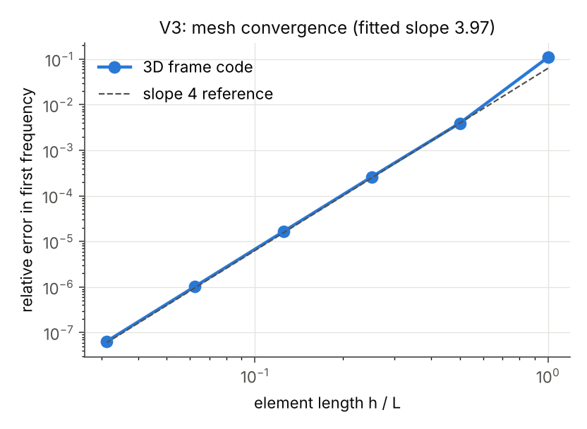
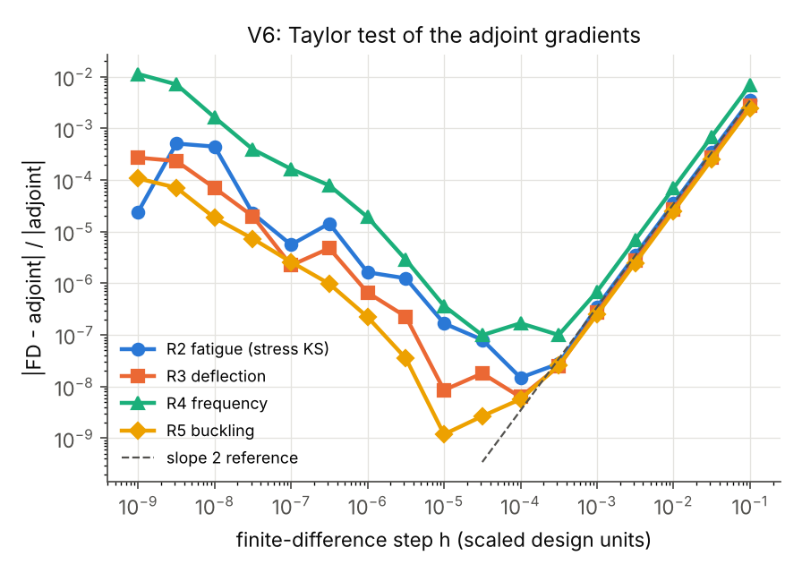
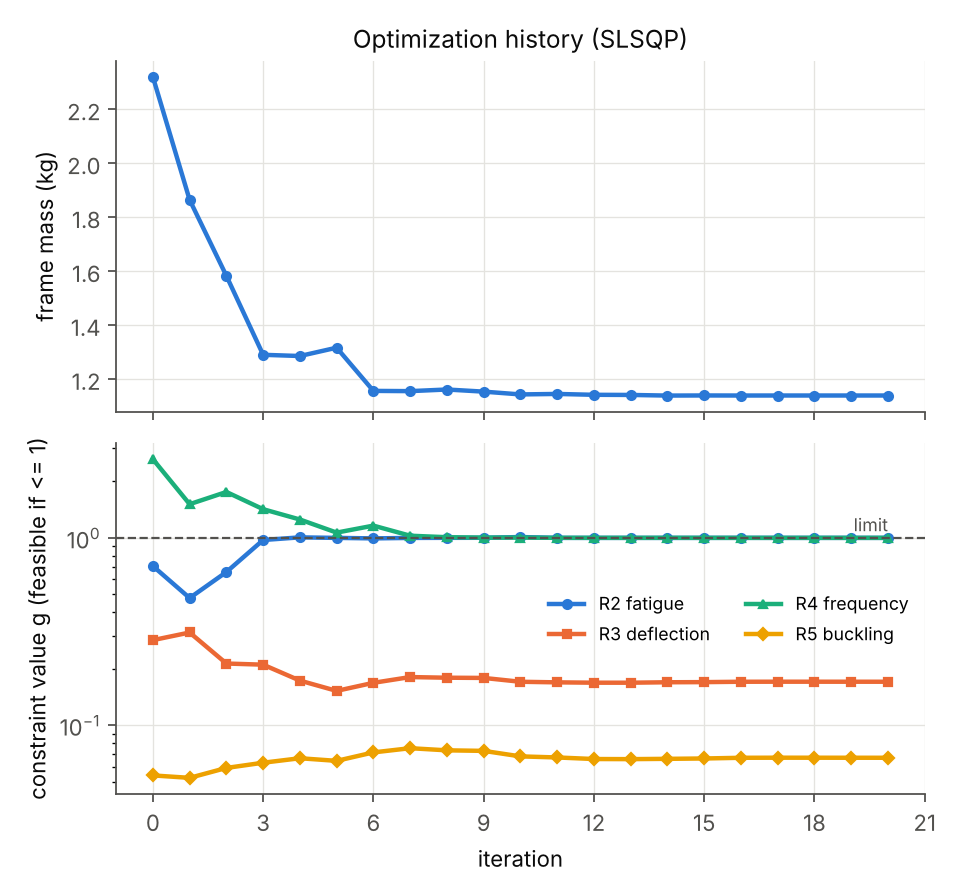
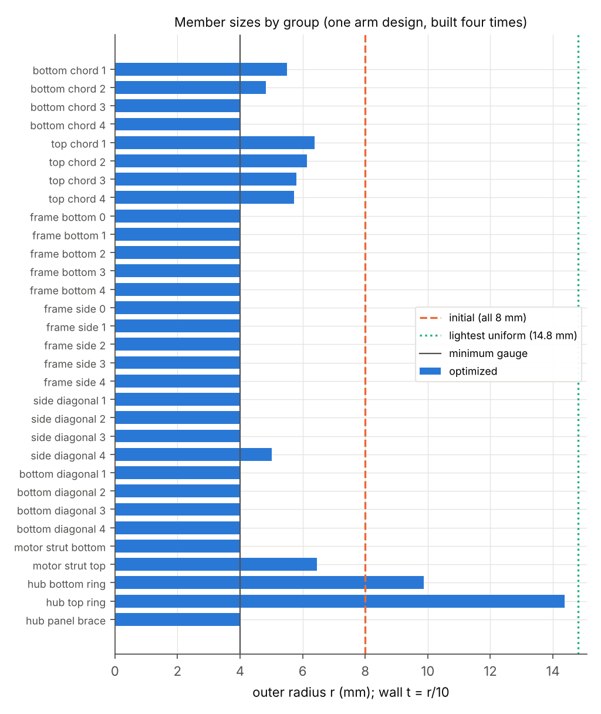
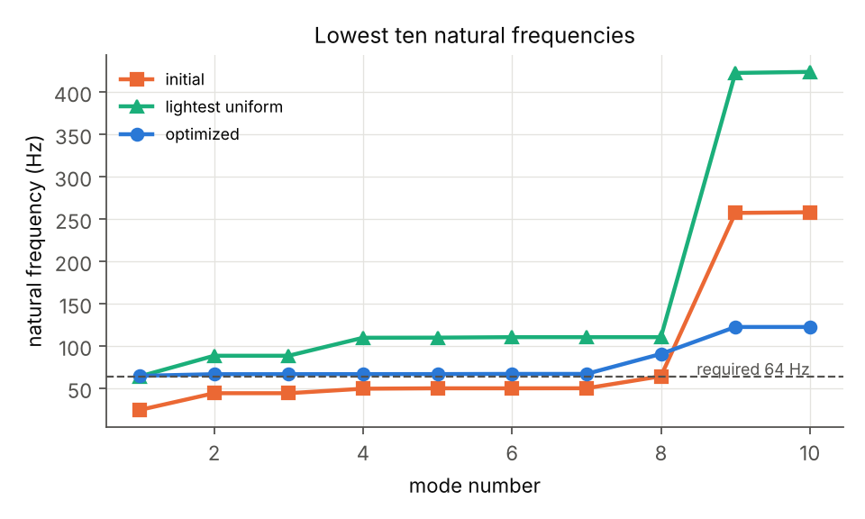

# Project IV: PDE-Constrained Design Optimization of a Heavy-Lift Quadcopter Airframe

**Adaptive Design Group.** Live report: this page on GitHub Pages. Code: `project4_*.py` in the repository. Every number on this page is written by `python project4_run_all.py`.

## Summary

Project 1 sized one hollow quadcopter arm with closed-form beam formulas and four variables. Project 4 designs the complete airframe of a 25 kg heavy-lift quadcopter as a 3D space frame of 184 aluminium tubes (368 beam elements, 1,488 degrees of freedom), with our own finite element solver, adjoint gradients for 35 design variables, and six requirements, two of which are eigenvalue problems (vibration and linear buckling).

| | Initial design | Lightest uniform design | **Optimized** |
|---|---:|---:|---:|
| Frame mass (tubes) | 2.320 kg | 7.952 kg | **1.139 kg** |
| Frame mass / take-off mass | 9.3% | 31.8% | **4.6%** |
| Arm depth root / tip | 100 / 60 mm | 100 / 60 mm | 200 / 40 mm |
| Arm width root / tip | 100 / 60 mm | 100 / 60 mm | 200 / 93 mm |
| R1 max von Mises stress (MPa, limit 184) | 28.8 ✓ | 6.0 ✓ | 41.1 ✓ |
| R2 Goodman fatigue factor of safety (limit 2.0) | 2.90 ✓ | 13.82 ✓ | 2.03 ✓ |
| R3 max motor deflection (mm, limit 2.0) | 0.56 ✓ | 0.12 ✓ | 0.33 ✓ |
| R4 lowest natural frequency (Hz, limit 64) | 24.3 ✗ | 64.0 ✓ | 64.7 ✓ |
| R5 linear buckling load factor (limit 3.0) | 122.7 ✓ | 1,765.5 ✓ | 88.1 ✓ |
| R6 max member slenderness L/r (limit 200) | 39 ✓ | 21 ✓ | 95 ✓ |

The starting design (all tubes 8 mm radius) fails the vibration requirement: its lowest mode is at 24.3 Hz, below the rotor frequency band. Making every tube the same size, just large enough to pass every requirement, needs r = 14.81 mm and 7.952 kg of aluminium. The optimizer (SLSQP, 35 variables, 20 iterations, about 33 s on a laptop) found a frame that passes every requirement with **1.139 kg: 86% less than the uniform design and 51% less than the (infeasible) starting design**. Two requirements are active at the optimum: vibration (R4), which sizes the chords, the hub rings and the arm cross-section, and fatigue (R2), whose limit is reached in the bottom motor-mount struts (already at the minimum tube size) and costs almost nothing. Buckling (R5) never becomes active; we show why below.

### Live 3D comparison

<div id="p4-viewer" data-src="assets/project4_results.json"></div>
<script type="module" src="assets/project4_viewer.js"></script>

The left view shows the initial design and the right view the optimized one (either side can show any of the three designs). Color shows the fatigue utilization of every element by default; choose "Animate: 1st vibration mode" to see the mode that governs the design, and "1st buckling mode" to see why buckling is not critical.

---

## 1. Structure and formulation

### 1.1 Why this structure

A multirotor airframe has two jobs that pull in opposite directions. Every gram of frame is a gram less of battery or payload, so the frame should be as light as possible. But the arms carry the full rotor thrust as a cantilever, the joints see one load cycle every time the throttle goes up and down, and above all the frame must not resonate with the rotors: a lightly damped arm mode near the rotor frequency feeds vibration into the flight controller's gyroscopes and into the camera or sensor payload. In Project 1 we sized one arm for stress and tip deflection only. Here we add the vibration requirement, which turns out to govern the design, and we let the optimizer choose the size of every tube and the cross-section of the arms.

### 1.2 Airframe concept

* **Hub:** an octagonal bottom ring, a square top ring and X-braced side panels, 0.15 m from the center to each arm root. The battery and payload box is bolted to four hard points at the middle of the bottom-ring members (the dark pyramids in the viewer).
* **Arms (four, identical):** triangular lattice booms, 0.50 m long, in four bays: two bottom chords and one top chord, a triangular cross frame at every station, two side diagonals and one bottom diagonal per bay. The motor radius is 0.65 m, which leaves 10% clearance between neighbouring 30-inch (0.762 m) propellers (the gray disks in the viewer), the clearance rule of Project 1.
* **Motor mount:** three struts from the tip cross frame to the motor plate, 40 mm above the top chord.
* **Tubes:** circular hollow sections (CHS) of aluminium 6061-T6, outer radius $r$, wall $t = r/10$ (one size variable per member, as in the course worked example).

### 1.3 Design variables

| Variables | Count | Units | Bounds | Notes |
|---|---:|---|---|---|
| Tube outer radius, per member group | 31 | mm | 4 to 20 | 28 groups per arm + 3 hub groups |
| Arm depth at root $h_r$, at tip $h_t$ | 2 | mm | 40 to 200, 30 to 120 | shape: moves every arm node |
| Arm width at root $w_r$, at tip $w_t$ | 2 | mm | 40 to 200, 30 to 120 | shape |

Grouping. The four arms share one set of sizes, because a builder makes one arm design four times (and the four arms see the same thrust). Left and right members of a mirror pair (the two bottom chords of a bay, the two side diagonals, the two sides of a cross frame) share a size. Every other member has its own size, by bay. All constraints are still evaluated on every element of all four arms. The lower bound of 4 mm (an 8 mm x 0.4 mm tube) is a minimum-gauge rule for handling and joining; the depth and width bounds keep the arm inside the hub packaging envelope.

The optimizer works on a scaled vector $x \in [0,1]^{35}$: radii are scaled logarithmically, $r = r_{\min}(r_{\max}/r_{\min})^{x}$, so that a unit step means the same relative change for a thin and a thick tube; shape variables are scaled linearly between their bounds.

### 1.4 Loads, material and requirements

| Item | Specification | Source |
|---|---|---|
| Take-off mass | 25 kg (heavy-lift class) | design assumption |
| Thrust | $T_{\max}$ = 120 N per motor (thrust-to-weight 1.96) | 30-inch propellers; consistent with $T = C_T \rho n^2 D^4$, $C_T \approx 0.1$, at 3,200 rpm |
| Rotor torque | $Q$ = 4 N m per motor, alternating CW/CCW | shaft power / rotor speed at $T_{\max}$ |
| Motor + prop + ESC | 0.9 kg at each motor | design assumption |
| Load case | full thrust climb: all four rotors at $T_{\max}$. The airframe accelerates upward at $n = 4T_{\max}/(m g)$ = 1.96 g, so every mass (tubes and motors) carries an inertial load $n g$ downward; the payload box reacts the rest | quasi-static d'Alembert |
| Supports | four payload hard points, clamped (bolted to a rigid battery box) | |
| Material | 6061-T6: $E$ = 68.9 GPa, $\nu$ = 0.33, $\rho$ = 2700 kg/m³, $S_y$ = 276 MPa, $S_u$ = 310 MPa, fatigue strength $S_f$ = 96.5 MPa at $5\times 10^8$ cycles | ASM Aerospace Specification Metals / MatWeb data sheet for 6061-T6 |
| Rotor frequency | 3,200 rpm at $T_{\max}$, so $f_{1P}$ = 53.3 Hz | |

**Objective.** Minimize the mass of the tubes, $m(x) = \sum_e \rho A_e L_e$ (motors and joints are fixed and not included).

| # | Requirement | Formula (load case above) |
|---|---|---|
| R1 | Static strength | $\max \sigma_{vm} \le S_y / 1.5$ = 184 MPa |
| R2 | Fatigue | Goodman factor of safety $n_f \ge 2$, i.e. $\max \sigma_{vm} \le$ 41.8 MPa (below) |
| R3 | Stiffness | vertical deflection of every motor $\vert u_z \vert \le 2$ mm |
| R4 | Vibration | lowest natural frequency (any mode shape) $f_1 \ge 1.2 f_{1P}$ = 64 Hz |
| R5 | Stability | linear buckling load factor $\lambda_{cr} \ge 3$ |
| R6 | Slenderness | every member $L/r_g \le 200$, $r_g = \tfrac12\sqrt{r^2 + (0.9r)^2}$ |

**Stress.** For a CHS element with end forces $(N, T, M_y, M_z)$, at both ends of every element,

$$
\sigma_{vm} = \sqrt{\left(\frac{|N|}{A} + \frac{\sqrt{M_y^2+M_z^2}\; r}{I}\right)^2 + 3\left(\frac{T r}{J}\right)^2},
\qquad A = \pi (r^2 - r_i^2),\quad I = \frac{\pi}{4}(r^4 - r_i^4),\quad J = 2I,\quad r_i = 0.9 r .
$$

**Fatigue (R2).** Every flight takes the frame from zero to full thrust and back, so the cycle is zero-based: $\sigma_a = \sigma_m = \sigma_{vm}/2$. Tube joints (welded or bonded nodes) lower the fatigue strength; we apply a fatigue strength factor $k_f = 0.5$, so the endurance strength is $S_e = k_f S_f$ = 48.25 MPa. The Goodman factor of safety and the requirement are

$$
\frac{1}{n_f} = \frac{\sigma_a}{S_e} + \frac{\sigma_m}{S_u}
\quad\Longrightarrow\quad
n_f \ge 2 \iff \sigma_{vm} \le \frac{2}{n_f\,(1/S_e + 1/S_u)} = \text{41.8 MPa}.
$$

As in the worked example, fatigue is far tighter than static strength, so R1 can never be active once R2 holds. We report both.

**Vibration (R4)** uses the lowest frequency of any mode, not "the first arm-bending mode", because classifying modes is a discrete choice that jumps when two modes swap order. The 20% margin above the once-per-revolution rotor frequency is the usual frequency-separation rule for rotating machinery. The four arms make the spectrum highly degenerate (pairs and near-quadruplets of equal frequencies), which is why R4 is aggregated over ten modes (Section 4).

**Buckling (R5)** and **slenderness (R6)** are the same as in the worked example: $\lambda_{cr} \ge 3$ covers imperfections, residual stresses and plasticity that a linear eigenvalue analysis ignores, and $L/r_g \le 200$ follows the AISC 360 recommendation for members that carry almost no load in the design case (in a quadcopter these members also carry crash and handling loads that are not in the load case).

---

## 2. Analysis model

**Governing equations.** Each tube obeys 3D linear elasticity. Euler-Bernoulli beam theory reduces it to ODEs along the member axis: axial $EA u'' + q_x = 0$, torsion $GJ\phi'' = 0$, and bending in two planes $EI v'''' = q_y$, $EI w'''' = q_z$. The finite element method turns the frame into

$$
K(x)\,u = F(x), \qquad K\phi = \omega^2 M \phi, \qquad (K + \lambda K_G(u))\,\psi = 0,
$$

with stiffness $K$, consistent mass $M$ (plus a 0.9 kg point mass at each motor), and geometric stiffness $K_G$, which is assembled from the axial forces of the static solution. $F$ depends on the design through the self-weight (inertial) load.

**Element.** A 2-node, 12-DOF space-frame element: cubic Hermite interpolation for bending, linear for axial and torsion, consistent mass matrix, and the standard geometric stiffness (with the torsional term $N J/(A L)$). Self-weight enters as consistent nodal loads. Every member has two elements (one cubic element cannot represent a member's own buckling mode). Joints are rigid.

**Mesh.** 248 nodes (64 joints, 184 member mid-nodes), 368 elements, 1,488 DOFs, 1,464 free after the four clamped mounts.

**Implementation.** `project4_frame.py` (generic, about 600 lines) keeps one vectorized element function separate from assembly, uses `scipy.sparse` for all global matrices, a sparse LU factorization for statics, shift-invert Lanczos (`eigsh`, reusing the LU factors) for vibration, and Lanczos on $-K_G\psi = \gamma K\psi$ with $\lambda = 1/\gamma$ for buckling. `project4_drone.py` holds the geometry, design variables, loads and requirements.

**Assumptions.** Linear elastic, small displacements; Euler-Bernoulli members (no shear deformation; members have $L/r \ge 20$); rigid joints with no joint mass or flexibility; motors as point masses (no rotary inertia); a single quasi-static load case (full-thrust climb), with the battery box rigid; fatigue from the zero-based thrust cycle only (no rotor-frequency vibratory stress); local wall buckling of thin tubes not checked (the optimized design has $D/t = 20$, well inside the compact range for aluminium tubes).

---

## 3. Verification

The expected value of every test was written from a textbook formula before the solver was called (`project4_verify.py`). Tests V1 to V4 use a 1 m aluminium tube with $r$ = 20 mm.

| Test | Quantity | Ours | Exact | Error | Pass |
|---|---|---:|---:|---|---|
| V1 | cantilever tip deflection, x-y plane | 0.0111948 | 0.0111948 | 1.2e-15 | ✓ |
| V1 | cantilever tip deflection, x-z plane | 0.0111948 | 0.0111948 | 1.5e-16 | ✓ |
| V1 | cantilever tip rotation, x-y plane | 0.0167922 | 0.0167922 | 3.1e-15 | ✓ |
| V1 | cantilever tip twist | 0.00446674 | 0.00446674 | 0.0e+00 | ✓ |
| V2 | simply supported midspan deflection (uniform q) | 0.000140953 | 0.000140953 | 1.9e-16 | ✓ |
| V2 | cantilever tip deflection (uniform q) | 0.00135315 | 0.00135315 | 8.0e-16 | ✓ |
| V2 | rotated cantilever: magnitude of tip displacement | 0.00135315 | 0.00135315 | 2.1e-13 | ✓ |
| V3 | SS beam first frequency, 8 elements (Hz) | 106.756 | 106.755 | 1.6e-05 | ✓ |
| V3 | convergence slope of frequency error vs h | 3.96883 | 4 | slope 3.97 vs 4 | ✓ |
| V4 | Euler column P_cr, 1 element(s) (N) | 35730.8 | 29387.4 | 21.59% (textbook value for cubic elements) | ✓ |
| V4 | Euler column P_cr, 2 element(s) (N) | 29608.5 | 29387.4 | 0.75% (textbook value for cubic elements) | ✓ |
| V4 | Euler column P_cr, 4 element(s) (N) | 29402.4 | 29387.4 | 0.05% (textbook value for cubic elements) | ✓ |
| V5 | free-free frame: number of zero-frequency modes | 6 | 6 | 7th frequency 16.42 Hz; largest of the six 2.6e-03 Hz | ✓ |
| V5 | sum of vertical reactions = applied vertical load (N) | 366.33 | 366.33 | 2.6e-14 | ✓ |
| V5 | moment balance: norm(M_react + M_applied) / (F L) | 4.70503e-13 | 0 | 4.7e-13 | ✓ |
| V5 | lowest frequency: sparse shift-invert vs dense (Hz) | 24.3466 | 24.3466 | 2.1e-09 | ✓ |
| V6 | adjoint vs central FD, worst of 24 checks | 4.0341e-06 | 0 | 4.0e-06 | ✓ |

* **V1, V2 (exact solutions).** Cubic Hermite elements with consistent loads reproduce the beam solutions to round-off. Rotating the whole cantilever (and its load) by a random 3D rotation leaves the result unchanged, which checks the coordinate transformations, including the special case for vertical members.
* **V3 (convergence rate).** The first-frequency error falls as $h^4$ (fitted slope 3.97), the rate expected for cubic elements with a consistent mass matrix.



* **V4 (buckling).** The pinned-pinned Euler load is overestimated by 21.6%, 0.75% and 0.05% with 1, 2 and 4 elements: the known discretization error of the cubic element, and the reason for at least two elements per member.
* **V5 (global balance, rigid-body modes).** The unsupported airframe has exactly six zero-frequency modes; reactions balance the applied loads (forces and moments) to round-off; the sparse Lanczos solver agrees with a dense eigensolver.
* **V6 (gradients).** Section 4.

---

## 4. Sensitivities

All gradients are computed by implicit differentiation (the adjoint method) of the state equation, as in the KKT notes, sections 7-8. Let $q$ be the physical design (node coordinates and element radii) and $x$ the scaled design vector; $q(x)$ is an explicit, cheap map whose derivative we take separately.

### 4.1 Static responses (R2 fatigue, R3 deflection)

For a response $f(q, u)$ with $R(q,u) = K(q)u - F(q) = 0$,

$$
\frac{df}{dq} = \frac{\partial f}{\partial q} - \lambda^T \frac{\partial R}{\partial q},
\qquad K \lambda = \frac{\partial f}{\partial u}
\quad(K \text{ is symmetric}).
$$

$\lambda$ is the Lagrange multiplier of the state equation. The global matrix derivative is never formed: $\lambda^T \partial R/\partial q = \sum_e \lambda_e^T(\partial k_e/\partial q \cdot u_e - \partial f_e/\partial q)$ is a sum of element contributions, each depending on the element's two nodes and its radius.

The 736 end stresses are aggregated with the Kreisselmeier-Steinhauser function, which is a smooth upper bound of the maximum:

$$
g_{R2} = \mathrm{KS}_\rho(s) = s_{\max} + \frac{1}{\rho}\ln\sum_k e^{\rho(s_k - s_{\max})},
\qquad s_k = \frac{\sigma_{vm,k}}{\sigma_{\text{allow}}},\quad \rho = 60 .
$$

Its derivative is $\partial g/\partial s_k = w_k$ (softmax weights), so one adjoint solve serves all 736 stresses. At the optimum the aggregate is 1.000 while the true maximum is 0.984: the KS bound is conservative by about 2%, and we report the true maximum. The four motor deflections are aggregated the same way ($\rho$ = 200) with a smooth absolute value.

### 4.2 Natural frequencies (R4)

For $K\phi_i = \omega_i^2 M\phi_i$ with $\phi_i^T M\phi_i = 1$, differentiating and multiplying by $\phi_i^T$ gives

$$
\frac{d\omega_i^2}{dq} = \phi_i^T\left(\frac{\partial K}{\partial q} - \omega_i^2 \frac{\partial M}{\partial q}\right)\phi_i ,
$$

with no extra solve (the eigenpair comes from `eigsh`, which we do not differentiate). Because the four arms make the spectrum degenerate (repeated and nearly repeated frequencies), we constrain the smooth aggregate $g_{R4} = \mathrm{KS}_{60}(f_{\text{req}}/f_i)$ over the ten lowest modes; the sum $\sum_i w_i d\omega_i^2$ is invariant to the choice of basis inside a repeated eigenspace because equal frequencies receive equal weights.

### 4.3 Buckling (R5): eigenvalue sensitivity with an adjoint through the state

For $(K + \lambda K_G)\psi = 0$ normalized $\psi^T K \psi = 1$ (so $\psi^T K_G\psi = -1/\lambda$),

$$
\frac{d\lambda}{dq} = \lambda\, \psi^T \left(\frac{\partial K}{\partial q} + \lambda \frac{d K_G}{d q}\right)\psi .
$$

$K_G$ depends on the design directly (lengths, orientations, $J/A$) and through the axial forces $N_e(q, u)$ of the static solution. The second part needs one adjoint solve per buckling aggregate:

$$
K\mu = \frac{\partial}{\partial u}\Big(\sum_i c_i \lambda_i^2\, \psi_i^T K_G(u)\psi_i\Big),
\qquad
\frac{dg}{dq} = \frac{\partial g}{\partial q}\Big|_{u} - \mu^T \frac{\partial R}{\partial q},
$$

where $c_i = \partial \mathrm{KS}/\partial \lambda_i$. R5 is aggregated over the eight lowest positive load factors.

### 4.4 Element derivatives

All element-level partial derivatives ($\partial k_e/\partial q$, $\partial m_e/\partial q$, $\partial(k_{G,e}N_e)/\partial q$, $\partial \sigma_{vm}/\partial q$, $\partial f_e/\partial q$) are computed by the **complex-step method**: the element function is evaluated with one of its seven inputs (six nodal coordinates and the radius) perturbed by $i h$, $h = 10^{-30}$, and $\partial F/\partial q_k = \mathrm{Im}[F(q + i h e_k)]/h$. There is no subtractive cancellation, so these derivatives are exact to machine precision. This is the course's implementation (ii), with complex step in place of an AD framework, so the code needs only numpy and scipy. Shape derivatives use the chain rule through $X(h_r, h_t, w_r, w_t)$, also by complex step on the geometry function. R6 is an explicit formula and is differentiated directly.

### 4.5 Gradient checks

Adjoint directional derivatives against central finite differences ($h = 10^{-6}$ in scaled units) in random directions, separately for size and shape variables, at a generic non-symmetric design (one trial of two shown; worst of all 24 checks: 4.0e-06):

| Response | Variables | Adjoint | Central FD | Relative error |
|---|---|---:|---:|---:|
| mass | size | 1.07690069e-01 | 1.07690069e-01 | 1.4e-09 |
| R2 | size | 5.05456969e-02 | 5.05458733e-02 | 3.5e-06 |
| R3 | size | 5.64092815e-02 | 5.64093811e-02 | 1.8e-06 |
| R4 | size | 6.61320736e-01 | 6.61323403e-01 | 4.0e-06 |
| R5 | size | 2.45923048e-02 | 2.45923088e-02 | 1.6e-07 |
| R6 | size | 3.82278843e-02 | 3.82278843e-02 | 2.2e-10 |
| mass | shape | -4.61929908e-01 | -4.61929908e-01 | 1.2e-10 |
| R2 | shape | 3.66835820e-01 | 3.66835948e-01 | 3.5e-07 |
| R3 | shape | 3.63983161e-01 | 3.63983249e-01 | 2.4e-07 |
| R4 | shape | 9.21740322e-01 | 9.21740792e-01 | 5.1e-07 |
| R5 | shape | 1.24915891e-02 | 1.24915907e-02 | 1.3e-07 |
| R6 | shape | -9.13510080e-03 | -9.13510079e-03 | 1.6e-09 |

The Taylor test below plots the FD error against the step. It falls as $h^2$ (the truncation error of central differences) down to about $10^{-8}$, then rises again as round-off takes over: the signature of a correct gradient. (A flat error curve would mean a bug.)



### 4.6 Cost

| | Time on our model |
|---|---:|
| One analysis (static + 10 modes + 8 buckling modes) | 0.12 s |
| Analysis + gradients of all 5 responses by adjoint | 1.62 s |
| Gradients by forward differences (36 analyses) | 4.5 s |
| Gradients by central differences (70 analyses) | 8.7 s |

The adjoint gradients cost about 13 analyses, and are 5.4 times cheaper than central differences (which are also only accurate to about $10^{-7}$). Our element derivatives by complex step are not the fastest possible implementation, and the ratio is modest because the model has only 35 variables: finite-difference cost grows with the number of design variables, while adjoint cost grows with the number of aggregated responses (5). Without the arm grouping (184 members + 4 shape variables) central differences would cost about 47 s per gradient against the same 1.62 s.

---

## 5. Optimization

**Algorithm and scaling.** SciPy SLSQP; objective $m(x)/m(x_0)$; four PDE-based constraints written as $1 - g_i(x) \ge 0$ with every $g_i$ already normalized by its limit; 184 explicit slenderness constraints; bounds $0 \le x \le 1$. Convergence tolerance $10^{-7}$ on the objective. The run converged in 20 iterations (22 analyses with gradients).



The mass drops fastest in the first three iterations while the optimizer removes material from lightly loaded members; at the same time the frequency constraint, violated at the start ($g_{R4}$ = 2.6), is driven down to 1 by moving material into the chords and the hub and by changing the arm cross-section. Fatigue reaches its limit at iteration 4 and frequency at about iteration 8; the remaining iterations trade material between the two active constraints.

**Starting designs and local optima.** Shape variables make the problem nonconvex, so we restarted from 3 random interior points ($x$ uniform in [0.2, 0.8]). All runs reached the same design: masses within less than 0.01 g and design vectors within 4.9e-04 (scaled units) of each other.

### 5.1 The optimized design

| Shape variable | Initial | Optimized | Bound |
|---|---:|---:|---|
| Arm depth at root $h_r$ (mm) | 100 | 200 | upper bound active |
| Arm depth at tip $h_t$ (mm) | 60 | 40 | |
| Arm width at root $w_r$ (mm) | 100 | 200 | upper bound active |
| Arm width at tip $w_t$ (mm) | 60 | 93 | |



The optimizer turned each arm into a tapered lattice: as deep and as wide as the hub allows at the root, where the bending moment and the modal strain energy are largest, and shallow at the tip, where depth only adds mass that moves in the vibration mode. Material went to the chords (the single top chord most, since it balances the two bottom chords) and to the hub rings, which tie the four arms together and carry their root moments into the payload mounts. 21 of the 31 groups (the cross frames, most diagonals, and the bottom-strut motor mount) sit at the 4 mm minimum gauge.

| Member group | Optimized radius (mm) | |
|---|---:|---|
| bottom chord 1 | 5.49 | |
| bottom chord 2 | 4.83 | |
| bottom chord 3 | 4.00 | minimum gauge |
| bottom chord 4 | 4.00 | minimum gauge |
| top chord 1 | 6.39 | |
| top chord 2 | 6.14 | |
| top chord 3 | 5.79 | |
| top chord 4 | 5.73 | |
| frame bottom 0 | 4.00 | minimum gauge |
| frame bottom 1 | 4.00 | minimum gauge |
| frame bottom 2 | 4.00 | minimum gauge |
| frame bottom 3 | 4.00 | minimum gauge |
| frame bottom 4 | 4.00 | minimum gauge |
| frame side 0 | 4.00 | minimum gauge |
| frame side 1 | 4.00 | minimum gauge |
| frame side 2 | 4.00 | minimum gauge |
| frame side 3 | 4.00 | minimum gauge |
| frame side 4 | 4.00 | minimum gauge |
| side diagonal 1 | 4.00 | minimum gauge |
| side diagonal 2 | 4.00 | minimum gauge |
| side diagonal 3 | 4.00 | minimum gauge |
| side diagonal 4 | 5.01 | |
| bottom diagonal 1 | 4.00 | minimum gauge |
| bottom diagonal 2 | 4.00 | minimum gauge |
| bottom diagonal 3 | 4.00 | minimum gauge |
| bottom diagonal 4 | 4.00 | minimum gauge |
| motor strut bottom | 4.00 | minimum gauge |
| motor strut top | 6.46 | |
| hub bottom ring | 9.88 | |
| hub top ring | 14.37 | |
| hub panel brace | 4.00 | minimum gauge |



The optimized design pushes its first six frequencies (64.7, 66.7, 66.7, 66.8, 66.8, 67.0 Hz) into a tight cluster just above the 64 Hz requirement. That clustering is typical of eigenvalue-constrained optima: any mode that is well above the limit has spare stiffness that the optimizer removes. In both designs the lowest mode is a "saddle" mode: one pair of opposite arms moves up while the other pair moves down, which twists the hub. In the initial design 83% of its strain energy is in the hub members, and it sits alone at 24.3 Hz, well below the next modes (44.2, 44.2, 49.5, 50.0, 50.0 Hz). That is why the optimizer made the hub top ring the thickest tube in the frame (48% of the mode's strain energy at the optimum).

### 5.2 KKT conditions and multipliers

At the optimum we solved the stationarity condition $\nabla m = \sum_i \mu_i \nabla g_i + \text{(bound multipliers)}$ on the active set by non-negative least squares (SLSQP in SciPy does not return multipliers). 21 variables are on their lower bound (minimum gauge) and 2 on their upper bound (root depth and width). The residual of the stationarity condition is 1.7e-04 (against a gradient norm of 0.464), so the point satisfies the KKT conditions.

| Active constraint | Multiplier $\mu$ (scaled) | Mass cost of the limit |
|---|---:|---|
| R4 vibration | 0.4903 | 1.138 kg per unit of $g_{R4} = f_{\text{req}}/f_1$: raising the frequency requirement by 1 Hz costs about 18 g of aluminium |
| R2 fatigue | 0.0027 | 0.006 kg per unit of $g_{R2}$: almost free |

By section 11 of the KKT notes, a multiplier is the change of the objective per unit relaxation of the limit. The engineering reading: **the frame is a vibration design**. Fatigue is on its limit through the KS aggregate: the most stressed members are the bottom motor-mount struts, which carry the thrust and rotor torque into the arm tip and reach 98% of the allowable stress while already at the 4 mm minimum gauge. Its multiplier is almost zero, so relaxing the fatigue rule would save only grams. Every Hz of frequency requirement costs about 18 g (1.6% of the frame mass). If the rotor speed at full thrust could be lowered (larger, slower propellers), the frequency requirement would drop with it, and each Hz of relief is worth about 18 g near this design. Deflection (R3, 0.33 mm of the 2 mm allowed), buckling and slenderness are inactive.

---

## 6. Nonlinear component: linear buckling (N1)

R5 is an N1 component: the eigenvalue problem $(K + \lambda K_G(u))\psi = 0$ has an operator that depends on the static state $u$ through the axial forces, and its gradient needs an eigenvalue sensitivity plus an adjoint solve through the state (Section 4.3).

**With and without R5.** We solved the problem twice. Without R5, SLSQP stopped after 20 iterations at 1.139 kg, at a design within 1.9e-13 (scaled units) of the design with R5: **identical**. The buckling load factor of the optimized frame is $\lambda_{cr}$ = 88.1, almost 30 times the requirement (initial design: 122.7; uniform design: 1,765.5).

**Why buckling does not matter here.** The arm is a cantilever whose root moment is carried by deep chords, so the axial forces stay moderate (at most 265 N of compression, in the root bay of the top chord), and the members that carry compression are short (125 mm bays) and among the thicker tubes. The members that the optimizer thins down to the minimum gauge are the ones that carry almost nothing. The binding requirement, vibration, needs stiffness, and a frame stiff enough to stay above 64 Hz is automatically far from buckling. Compare the worked footbridge, a 15 m simply supported span with long compression members, where buckling and slenderness are the natural limits. A bow imperfection in the most critical member would grow by at most $1/(1 - 1/\lambda_{cr})$ = 1.011 times, so the linear analysis is trustworthy at the design load, and neither a geometrically nonlinear analysis nor an imperfection study would change the design.

The first buckling mode is shown in the viewer ("Animate: 1st buckling mode"): the compressed top chords of bays 2 and 3 bow between the cross frames, in all four arms at once. It is a member mode, not a global instability of the airframe.

---

## 7. Results

| | Initial | Lightest uniform | Optimized | Optimized without R5 |
|---|---:|---:|---:|---:|
| Frame mass (kg) | 2.320 | 7.952 | 1.139 | 1.139 |
| R1 max von Mises (MPa) | 28.8 ✓ | 6.0 ✓ | 41.1 ✓ | same |
| R2 Goodman $n_f$ | 2.90 ✓ | 13.82 ✓ | 2.03 ✓ | same |
| R3 motor deflection (mm) | 0.56 ✓ | 0.12 ✓ | 0.33 ✓ | same |
| R4 lowest frequency (Hz) | 24.3 ✗ | 64.0 ✓ | 64.7 ✓ | same |
| R5 buckling factor | 122.7 ✓ | 1,765.5 ✓ | 88.1 ✓ | same (not constrained) |
| R6 max slenderness | 39 ✓ | 21 ✓ | 95 ✓ | same |

For context, Project 1 sized a single carbon-fibre arm of a small quadcopter (12.4 g per arm) for stress and tip deflection only. In this 25 kg class airframe the frequency requirement is what makes the frame heavy: the uniform design would spend 31.8% of the take-off mass on tubes, the optimized design 4.6%.

---

## 8. Limitations

* One quasi-static load case. A real airframe also needs hard-landing, crash and transport cases, an asymmetric (one motor out) case, and the vibratory stress at the rotor frequency in the fatigue check. The minimum gauge and the slenderness rule stand in for these unmodelled loads, in the same way the worked example's R6 does.
* Rigid joints without mass. Joint fittings or welds add mass and some flexibility, which lowers the frequencies; a real design would add a margin.
* The payload box is modeled as rigid and clamped; a flexible battery tray would lower the hub modes.
* Euler-Bernoulli beams, linear elasticity; no local wall buckling check.
* The fatigue strength factor $k_f = 0.5$ for joints is an engineering estimate, not a detail-category value from a standard (Eurocode 9 or the Aluminum Design Manual would be the next step).
* Arms are grouped (four identical arms, mirror-symmetric pairs). Ungrouped sizing could save a little more mass, at the cost of four different arm designs.

---

## 9. AI-use statement

We used a coding agent (Claude) to write the finite element code, the drone model, the optimization scripts, the three.js viewer and a first draft of this report. Our checks:

* **Derived or checked by us:** every expected value in the verification ladder (closed-form beam, column and frequency formulas) was written into `project4_verify.py` before the solver was called; the requirement formulas (Goodman, KS, frequency margin) and their limits; the load case and the load-factor reasoning; the interpretation of the multipliers.
* **Written by the agent and checked by verification:** element matrices (stiffness, consistent mass, geometric stiffness, consistent loads), coordinate transformations, assembly, eigen-solvers, adjoint formulas, and the viewer's Hermite interpolation.
* **One bug the checks caught.** The first model pinned the payload mounts (translations only). Its lowest mode, at 18.8 Hz, was the frame rocking on the four pins and bending the hub ring members: a modeling error, not an airframe mode (a battery box is bolted, not pinned). Inspecting the lowest mode shape exposed it, and we clamped the mounts. A second issue was in the ladder itself: the dense eigensolver returns the six rigid-body frequencies of the free airframe at about $3 \times 10^{-3}$ Hz rather than 0, so the zero-mode count needs a round-off tolerance relative to the first elastic frequency, not an absolute one.
* **What we did not let the agent do:** speed up the adjoint (for example by "Jacobian-free" approximations); every gradient is checked against finite differences.

---

## 10. Reproducibility

```bash
pip install numpy scipy matplotlib
python project4_run_all.py        # about 4 minutes
```

| File | Purpose |
|---|---|
| `project4_frame.py` | generic 3D frame FE code: element matrices, assembly, statics, eigenproblems, KS aggregation, adjoint and eigenvalue sensitivities |
| `project4_drone.py` | quadcopter geometry, design variables and scaling, loads, requirements R1-R6 |
| `project4_verify.py` | verification ladder V1-V6, Taylor test, cost comparison -> `project4_verification.json` |
| `project4_optimize.py` | lightest uniform design, optimization with and without R5, random restarts, KKT multipliers -> `project4_optimization.json` |
| `project4_finalize.py` | `assets/project4_results.json` for the viewer, figures, and this report from `project4_report_template.md` |
| `project4_run_all.py` | runs all of the above |
| `assets/project4_viewer.js` | three.js viewer |
| `_config.yml`, `_layouts/default.html` | GitHub Pages (Jekyll) setup: MathJax and three.js |

The analysis is deterministic; the random restarts and gradient-check directions use fixed seeds.

## References

* ASM Aerospace Specification Metals, Aluminum 6061-T6 data sheet (via MatWeb).
* AISC 360, *Specification for Structural Steel Buildings*, slenderness recommendation $KL/r \le 200$.
* Kreisselmeier, G., & Steinhauser, R. (1979). Systematic control design by optimizing a vector performance index. *IFAC Proceedings*, 12(7), 113-117.
* Martins, J. R. R. A., Sturdza, P., & Alonso, J. J. (2003). The complex-step derivative approximation. *ACM Transactions on Mathematical Software*, 29(3), 245-262.
* Seyranian, A. P., Lund, E., & Olhoff, N. (1994). Multiple eigenvalues in structural optimization problems. *Structural Optimization*, 8, 207-227.
* Ren, Y. *An Introduction to Optimization for Mechanical Engineers*, Project 4 notes and KKT notes, sections 7-11.
